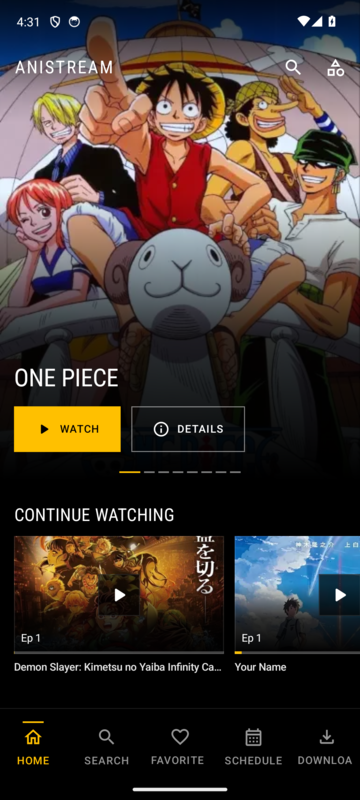
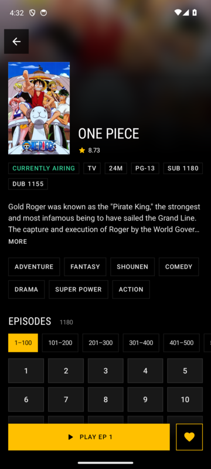
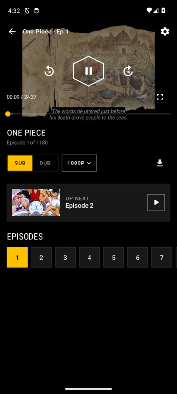
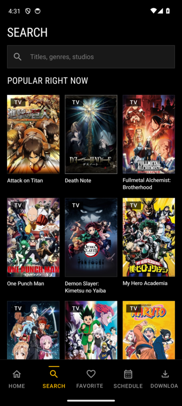
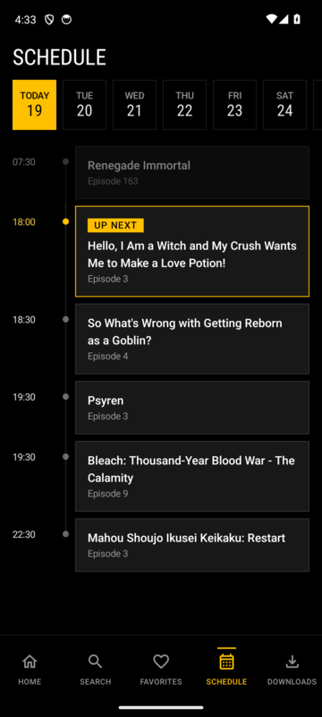
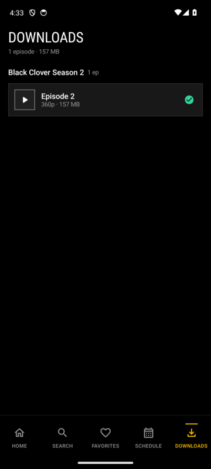

# AniStream

A native Android anime streaming app. It is built on the same scraping approach as [ani-cli](https://github.com/pystardust/ani-cli), wrapped in a dark, gold-accented UI.

<p>
  
  
  
</p>
<p>
  
  
  
</p>

## Install

Download the latest APK from [Releases](../../releases/latest) and open it on your phone (Android 8.0+, allow "install unknown apps" when asked).

Every push to `main` builds a signed APK and publishes it as a new release (`v1.0.<build>`). Every release from v1.0.1 onward installs as an update over the previous one. v1.0.0 was signed with a different key, so uninstall it once before installing a newer build.

## Features

- **Home**: Trending hero carousel, Continue Watching with progress, and Latest Episodes, Top Airing, Most Popular, Most Favorite and Latest Completed rows.
- **Player**: In-app HLS player with 360p to 1080p quality switching that keeps your position. Includes Sub/Dub (falls back to Sub when a dub isn't out yet), English subtitles, ±10s buttons and double-tap seek, landscape fullscreen, prev/next, an episode strip, and a 5-second next-episode countdown.
- **Resume anywhere**: Watch progress is saved every 10s, and you resume where you left off.
- **Downloads**: Save any episode in the quality you're watching, with its subtitles, and play it offline.
- **Anime detail**: Synopsis, genres, seasons, recommendations, and an episode grid with range tabs for long-running shows (One Piece's 1180 episodes included).
- **Search**: Search with type filters, recent searches and a "popular right now" grid.
- **Browsing**: Genre browsing with infinite scroll, a 7-day airing schedule in your local time, and favorites.
- **Movies**: Supported. Titles that are listed but not yet uploaded show a clear "not available yet" message instead of an error.

## How it works

The content source is `hianime.at`, the same provider ani-cli switched to in v5.1:

1. Search, home and detail pages are parsed with Jsoup.
2. Episodes come from `/api/theme/episode/list/<id>`, and servers from `/api/theme/episode/servers?episodeId=<id>`.
3. The ZokoAnime embed carries its player config as `base64(json XOR "otaku-embed-v1")`. That decodes to the master `.m3u8` and a `.vtt` subtitle track.
4. The stream, segment and subtitle hosts return HTTP 403 without `Referer: https://zokoanime.video/`. ExoPlayer and the downloader both send it.

## Architecture

The app uses Clean Architecture with multiple modules, Hilt, Coroutines/Flow, Room, Media3 ExoPlayer and Jetpack Compose (Material 3).

```
app/                    NavGraph, DI, theme
domain/                 models, repository contracts, use cases
core/common             Result type
core/parser             HianimeParser (pure JVM, unit-tested against real fixtures)
core/network            OkHttp client, repository implementations, downloader
core/database           Room (watch history, favorites, downloads)
core/ui                 design system tokens + shared components
feature/*               home, search, anime-detail, player, favorites, downloads, schedule, genre-browse
```

The design system ("Nocturne") is adapted from the Lamborghini spec in [awesome-design-md](https://github.com/VoltAgent/awesome-design-md). It uses a true-black canvas, a single gold accent, sharp corners and condensed uppercase display type. See [`DESIGN.md`](DESIGN.md).

## Build

```bash
./gradlew assembleDebug                 # app/build/outputs/apk/debug/app-debug.apk
./gradlew :core:parser:testDebugUnitTest
```

Requires JDK 17+ and the Android SDK (compileSdk 35).

## Disclaimer

AniStream hosts nothing; it only fetches what third-party sites already serve publicly. Use it at your own risk and within your local laws. See [DISCLAIMER.md](DISCLAIMER.md). Licensed under GPL-3.0, like ani-cli.
